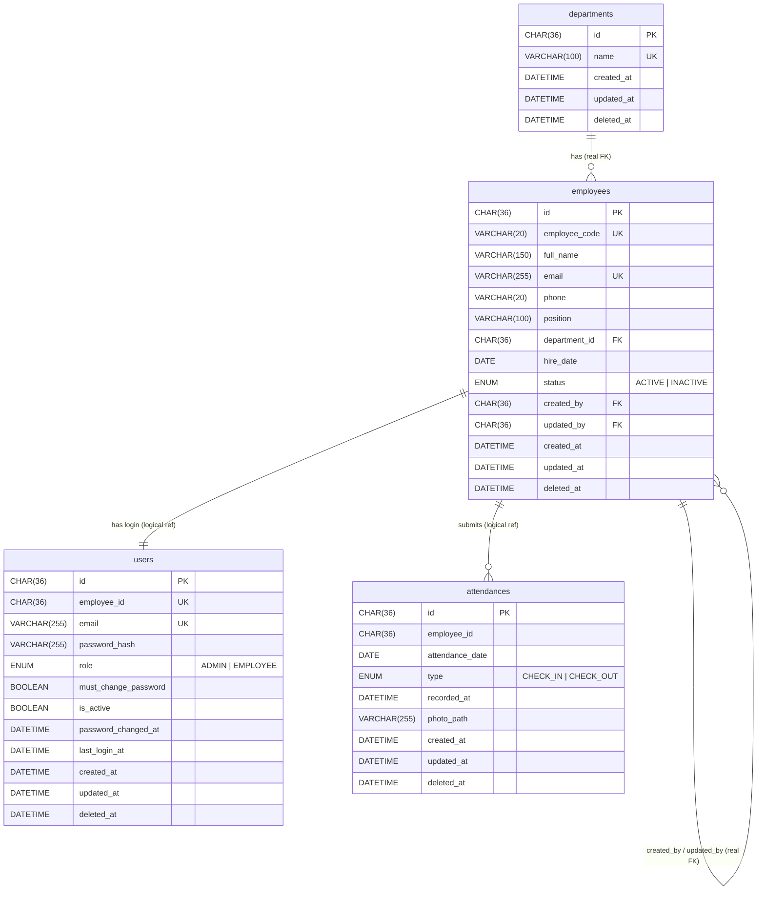

# Database Design

MySQL 8.4 with Sequelize (models in `apps/<service>/src/`, migrations in `apps/<service>/migrations/`), **one database per service**. Each service is the only one that reads or writes its database. Other services get that data by sending a message to the owning service.

| Database | Owned by | Tables |
|----------|----------|--------|
| `dexa_auth` | auth service | `users` |
| `dexa_employee` | employee service | `departments`, `employees`, `sequences` |
| `dexa_attendance` | attendance service | `attendances` |

## Conventions

- **IDs**: UUID stored as `CHAR(36)`. Not guessable in URLs (`/employees/5`), and unique across services.
- **Names**: `snake_case` tables and columns, plural table names. Model attributes use the **same snake_case names** (`user.employee_id`), and so do API JSON and frontend types: one name from MySQL to the browser.
- **Time**: every `DATETIME` is stored in **UTC**. The business day (`attendance_date`) is calculated in **Asia/Jakarta**.
- **Timestamps**: every table has `created_at`, `updated_at` and `deleted_at`, filled by Sequelize (`timestamps: true`, `paranoid: true`, with the timestamp attributes renamed to `created_at` / `updated_at` / `deleted_at`; `@CreatedAt`, `@UpdatedAt`, `@DeletedAt` in the models).
- **Soft delete everywhere**: rows are never removed. "Deleting" sets `deleted_at`, and every normal query automatically skips rows where `deleted_at IS NOT NULL` (see [Soft delete](#soft-delete)).
- **Charset**: `utf8mb4` / `utf8mb4_unicode_ci` (set when the databases are created).
- **Inactive vs deleted**: `INACTIVE` means the employee left. They're still listed for HR and their history stays visible. Soft-deleted means the record shouldn't exist (e.g. created by mistake) and it is hidden everywhere.

## Roles

**Every user is an employee.** HR staff have an employee record like everyone else, plus the `ADMIN` role.

| Role | Can do |
|------|--------|
| `EMPLOYEE` | Log in, change own password, check in / check out, view own attendance |
| `ADMIN` (HR) | **Everything `EMPLOYEE` can**, plus create and update employees (including their role), and view everyone's attendance (read only) |

- The gateway enforces this: `RolesGuard` treats `ADMIN` as also allowed on `EMPLOYEE` endpoints.
- The first `ADMIN` comes from the seed. After that, an `ADMIN` can create or promote other `ADMIN`s (a real HR team has several people), within the guardrails below.

### Role management guardrails

`role` lives in `dexa_auth.users`, so the **auth service** enforces these rules. The gateway passes the acting user (`actor_user_id`, from the JWT's `sub`) with every role, deactivation or delete request.

| # | Rule | Where | Error |
|---|------|-------|-------|
| 1 | Only an `ADMIN` can set `role`, on create or update. Default is `EMPLOYEE`; any other value is rejected by the DTO | Gateway: `RolesGuard` + `ValidationPipe` (`role` must be `ADMIN` or `EMPLOYEE`) | `403` / `400` |
| 2 | Nobody can change **their own** role, deactivate or delete **themselves** | Auth service: `actor_user_id` must differ from the target user | `403 Forbidden` |
| 3 | The **last active `ADMIN`** can't be demoted, deactivated or deleted | Auth service, inside a transaction (see below) | `409 Conflict` |
| 4 | Every change is recorded: `employees.updated_by` = the acting HR employee; `users.updated_at` = when | Employee and auth services | — |

**Rule 3 is race-safe.** Two HR admins demoting each other at the same moment could otherwise both see "another admin still exists" and leave zero admins. The auth service runs the check and the change in one transaction and locks the admin rows first:

```sql
SELECT id FROM users WHERE role = 'ADMIN' AND is_active = TRUE AND deleted_at IS NULL FOR UPDATE;
-- refuse if the target is the only row returned, otherwise apply the change, then commit
```

The second request waits for the first to commit, then sees one admin left and is refused.

**What counts as removing an admin** (all go through rules 2 and 3): changing `role` to `EMPLOYEE`, setting the employee `INACTIVE` (which sets `users.is_active = FALSE`), and soft-deleting the employee (which soft-deletes the user).

**Not covered here** (production extras, out of scope): a separate super-admin role, or a second person approving role changes. A demoted or deactivated admin's current JWT keeps working until it expires (see the known limitation under [Cross-database rules](#cross-database-rules)).

## Relationships



Every table also has the hidden `not_deleted` column used by unique keys.

**Real FK** = a MySQL foreign key (same database). **Logical ref** = an ID pointing into another service's database. MySQL can't enforce it, so the gateway checks it (see [Cross-database rules](#cross-database-rules)).

---

## `dexa_auth`

### `users`

Login credentials and role. The only place passwords exist.

| Column | Type | Null | Default | Notes |
|--------|------|------|---------|-------|
| `id` | CHAR(36) | no | | PK, UUID |
| `employee_id` | CHAR(36) | no | | Logical ref to `employees.id`. Every user is an employee |
| `email` | VARCHAR(255) | no | | Login name, stored lowercase, same value as `employees.email` |
| `password_hash` | VARCHAR(255) | no | | bcrypt hash (`bcryptjs`, cost 12), never the plain password |
| `role` | ENUM('ADMIN','EMPLOYEE') | no | 'EMPLOYEE' | Read into the JWT at login, checked by the gateway's `RolesGuard` |
| `must_change_password` | BOOLEAN | no | TRUE | TRUE while the user still has the system-generated password |
| `password_changed_at` | DATETIME | yes | NULL | Set when the user changes their password |
| `is_active` | BOOLEAN | no | TRUE | FALSE blocks login. Kept in sync with `employees.status` |
| `last_login_at` | DATETIME | yes | NULL | Updated on each successful login |
| `created_at` | DATETIME | no | now | |
| `updated_at` | DATETIME | no | now | |
| `deleted_at` | DATETIME | yes | NULL | Soft delete: set when deleted, NULL while the row is live |
| `not_deleted` | TINYINT | yes | *generated* | `1` while live, `NULL` once deleted. Only used by unique keys (see [Soft delete](#soft-delete)); hidden from the app |

| Index | Columns | Why |
|-------|---------|-----|
| PRIMARY | `id` | |
| UNIQUE `uq_users_email` | `email`, `not_deleted` | One live login per email; login looks up by email |
| UNIQUE `uq_users_employee_id` | `employee_id`, `not_deleted` | Exactly one live login per employee |

#### Generated password flow

1. When HR creates an employee, the **auth service** generates a random password (16 characters, using `crypto.randomBytes`), stores only its bcrypt hash, and sets `must_change_password = TRUE`.
2. The plain password is returned **once** in the create-employee response, so HR can hand it to the employee. It is never stored, logged or retrievable later.
3. The JWT includes `mustChangePassword`. While it is `true`, the gateway only allows `POST /auth/change-password` and `GET /auth/me`; every other endpoint returns `403`.
4. After the change: `must_change_password = FALSE`, `password_changed_at = now`, and the user logs in again for a normal token.

---

## `dexa_employee`

### `departments`

Lookup table, filled by the seed. HR picks from it when creating an employee.

| Column | Type | Null | Default | Notes |
|--------|------|------|---------|-------|
| `id` | CHAR(36) | no | | PK, UUID |
| `name` | VARCHAR(100) | no | | e.g. "Engineering", "Human Resources" |
| `created_at` | DATETIME | no | now | |
| `updated_at` | DATETIME | no | now | |
| `deleted_at` | DATETIME | yes | NULL | Soft delete: set when deleted, NULL while the row is live |
| `not_deleted` | TINYINT | yes | *generated* | `1` while live, `NULL` once deleted. Only used by unique keys (see [Soft delete](#soft-delete)); hidden from the app |

| Index | Columns | Why |
|-------|---------|-----|
| PRIMARY | `id` | |
| UNIQUE `uq_departments_name` | `name`, `not_deleted` | No duplicate live departments |

### `employees`

HR master data, including HR staff themselves. No password and no role: those belong to auth.

| Column | Type | Null | Default | Notes |
|--------|------|------|---------|-------|
| `id` | CHAR(36) | no | | PK, UUID |
| `employee_code` | VARCHAR(20) | no | | `EMP-0001`, `EMP-0002`, … The ID people see. **Generated by the system** from the [`sequences`](#sequences) counter, never typed by HR. Never reused |
| `full_name` | VARCHAR(150) | no | | |
| `email` | VARCHAR(255) | no | | Work email, stored lowercase, same value as `users.email` |
| `phone` | VARCHAR(20) | yes | NULL | |
| `position` | VARCHAR(100) | no | | e.g. "Frontend Developer" |
| `department_id` | CHAR(36) | no | | **FK** to `departments.id`, `ON DELETE RESTRICT` |
| `hire_date` | DATE | no | | |
| `status` | ENUM('ACTIVE','INACTIVE') | no | 'ACTIVE' | Deactivate instead of delete |
| `created_by` | CHAR(36) | yes | NULL | **FK** to `employees.id`: the HR employee who created this row. NULL only for seeded rows |
| `updated_by` | CHAR(36) | yes | NULL | **FK** to `employees.id`: the HR employee who last updated it |
| `created_at` | DATETIME | no | now | |
| `updated_at` | DATETIME | no | now | |
| `deleted_at` | DATETIME | yes | NULL | Soft delete: set when deleted, NULL while the row is live |
| `not_deleted` | TINYINT | yes | *generated* | `1` while live, `NULL` once deleted. Only used by unique keys (see [Soft delete](#soft-delete)); hidden from the app |

`created_by` and `updated_by` point to other employees in the **same** database, so they are real foreign keys (`ON DELETE RESTRICT`). The gateway fills them with the `employee_id` from the HR user's JWT.

| Index | Columns | Why |
|-------|---------|-----|
| PRIMARY | `id` | |
| UNIQUE `uq_employees_code` | `employee_code`, `not_deleted` | No duplicate live codes |
| UNIQUE `uq_employees_email` | `email`, `not_deleted` | No duplicate live emails |
| INDEX `idx_employees_department` | `department_id` | FK lookup, filter by department |
| INDEX `idx_employees_name` | `full_name` | HR search by name (prefix search) |
| INDEX `idx_employees_created_by` | `created_by` | FK lookup |
| INDEX `idx_employees_updated_by` | `updated_by` | FK lookup |

Sort employee lists by `created_at` (or by the number in the code), not by `employee_code` as text: as text, `EMP-10000` sorts before `EMP-9999`.

### `sequences`

Counters for human-readable codes. One row per counter; today only `employee_code`. Accessed with raw SQL by `EmployeeCodeService` (no model).

| Column | Type | Null | Default | Notes |
|--------|------|------|---------|-------|
| `name` | VARCHAR(50) | no | | PK, e.g. `employee_code` |
| `last_number` | INT UNSIGNED | no | 0 | Last number handed out. (`last_value` would clash with MySQL 8's reserved word `LAST_VALUE`) |
| `created_at` | DATETIME | no | now | |
| `updated_at` | DATETIME | no | now | |
| `deleted_at` | DATETIME | yes | NULL | Kept for consistency with every other table; counters are never deleted |

#### How an employee code is generated (race-free)

Inside the transaction that creates the employee:

1. `SELECT last_number FROM sequences WHERE name = 'employee_code' FOR UPDATE`: **locks** the counter row.
2. `UPDATE sequences SET last_number = last_number + 1`.
3. `INSERT INTO employees (..., employee_code = 'EMP-0042')`, then commit, which releases the lock.

- **Two HR users at the same moment**: the second waits at step 1 until the first commits, then gets the next number. Both succeed; nobody sees an error. (Tested: 20 simultaneous creates gave 20 consecutive, unique codes.)
- **A create that fails** rolls back steps 1–3 together, so its number is handed out again: no gaps from failed creates. (A create undone later by the gateway's compensating action is already committed, so its number stays used.)
- **Format**: `EMP-` + the number padded to **at least** 4 digits, done in TypeScript (`formatEmployeeCode`): `EMP-0001` … `EMP-9999`, `EMP-10000`. MySQL's `LPAD(n, 4)` is not used because it truncates (`10000` → `1000`).
- **Not `AUTO_INCREMENT`**: MySQL does not allow a generated column to refer to an auto-increment column (error 3109), and `AUTO_INCREMENT` leaves gaps on rollback.
- **Migration start value**: the counter starts at the highest existing `EMP-` number, including soft-deleted employees, so old codes are never handed out again.

---

## `dexa_attendance`

### `attendances`

One row per clock event, with a photo as proof of working from home. No flow edits a row; `updated_at` exists for consistency and changes only on soft delete.

| Column | Type | Null | Default | Notes |
|--------|------|------|---------|-------|
| `id` | CHAR(36) | no | | PK, UUID |
| `employee_id` | CHAR(36) | no | | Logical ref to `employees.id`, taken from the JWT, never from the request body |
| `type` | ENUM('CHECK_IN','CHECK_OUT') | no | | |
| `attendance_date` | DATE | no | | Working day in Asia/Jakarta, calculated by the server |
| `recorded_at` | DATETIME(3) | no | | Exact time in UTC, **set by the server**, never sent by the client |
| `photo_path` | VARCHAR(255) | no | | Relative to `UPLOAD_DIR`, e.g. `attendance/2026/11/<uuid>.jpg` |
| `photo_mime` | VARCHAR(50) | no | | `image/jpeg`, `image/png` or `image/webp`, checked on upload |
| `photo_size` | INT UNSIGNED | no | | Bytes, at most `UPLOAD_MAX_SIZE_MB` |
| `notes` | VARCHAR(255) | yes | NULL | Optional message from the employee |
| `created_at` | DATETIME | no | now | |
| `updated_at` | DATETIME | no | now | |
| `deleted_at` | DATETIME | yes | NULL | Soft delete: set when deleted, NULL while the row is live |
| `not_deleted` | TINYINT | yes | *generated* | `1` while live, `NULL` once deleted. Only used by unique keys (see [Soft delete](#soft-delete)); hidden from the app |

| Index | Columns | Why |
|-------|---------|-----|
| PRIMARY | `id` | |
| UNIQUE `uq_attendance_employee_day_type` | `employee_id`, `attendance_date`, `type`, `not_deleted` | At most one live check-in and one live check-out per employee per day, enforced by the database. Also serves "my attendance" queries |
| INDEX `idx_attendance_date` | `attendance_date` | HR monitoring list, filtered by date range |

#### Check-in / check-out rules (attendance service)

| Rule | Error |
|------|-------|
| Check-in: at most once per day | `409 Conflict`: already checked in today |
| Check-out: only after a check-in on the **same** day | `400 Bad Request`: not checked in today |
| Check-out: at most once per day | `409 Conflict`: already checked out today |
| Both need a photo | `400 Bad Request` |

A day's status is derived, not stored: **check-in only** = still working (or forgot to check out), **both** = complete. Work duration = check-out `recorded_at` − check-in `recorded_at`.

---

## Soft delete

Nothing is ever removed with `DELETE`. Deleting a row sets `deleted_at = now`: with `paranoid: true`, Sequelize's `destroy()` does a soft delete and adds `WHERE deleted_at IS NULL` to every normal query, so deleted rows disappear from the app automatically. Pass `paranoid: false` to a query to include them. They stay in the database for history and can be restored (`restore()` sets `deleted_at` back to NULL).

### Unique keys that ignore deleted rows

A plain `UNIQUE (email)` would still count soft-deleted rows, so a deleted employee's email or code could never be used again. MySQL has no "partial" unique index, so each table gets a generated column:

```sql
not_deleted TINYINT AS (IF(deleted_at IS NULL, 1, NULL)) STORED
UNIQUE KEY uq_employees_email (email, not_deleted)
```

MySQL allows any number of `NULL`s in a unique key. Live rows all have `1`, so they must be unique. Deleted rows have `NULL`, so they never clash with anything. The column exists only in the migrations: the Sequelize models don't declare it, so the app never reads or writes it.

### What soft delete does in each flow

| Action | Effect |
|--------|--------|
| **Delete employee** | Soft-deletes the `employees` row, then the gateway soft-deletes the matching `users` row (`auth.delete-user`), so the person can no longer log in. Their attendance rows are **kept** as history |
| **Create employee fails at the auth step** | The compensating action soft-deletes the just-created employee. Its email and code stay free for the retry (thanks to `not_deleted`) |
| **Delete department** | Refused with `409 Conflict` while live employees are in it. `ON DELETE RESTRICT` only applies to real `DELETE`s, so the employee service checks this itself |
| **Delete attendance record** | Soft-deletes the row. The photo file stays on disk, because the record can be restored |
| **HR attendance view** | Hides deleted attendance rows. Names of **deleted employees** are still looked up (`paranoid: false`), so their old records show a name instead of a blank |
| **Login** | A soft-deleted user is not found, so login fails like a wrong email |
| **Restore** | Refused with `409 Conflict` if a live row now uses the same unique value (e.g. the email was reused after the delete). The `not_deleted` key enforces this in MySQL too |

The brief only asks HR to add and update employees, so a "delete employee" endpoint is optional. If built, it should be `ADMIN` only and call the soft delete above.

## Cross-database rules

MySQL can't have foreign keys between databases, so the gateway enforces these when it coordinates the services:

| Rule | How |
|------|-----|
| `users.employee_id` → `employees.id` | **Create employee**: the gateway creates the employee first, then the user with that `id`. If creating the user fails, it soft-deletes the just-created employee (compensating action), so there is never a live employee without a login |
| `attendances.employee_id` → `employees.id` | The ID comes from a valid JWT, and inactive users can't log in |
| `employees.email` = `users.email` | Same value on create. On an email update, the gateway calls `employee.update`, then `auth.update-email`, and reverts the employee email if the second step fails |
| `employees.status` ↔ `users.is_active` | Setting an employee `INACTIVE` also sets `users.is_active = FALSE` (and back for `ACTIVE`) |
| `employees.deleted_at` ↔ `users.deleted_at` | Soft-deleting an employee also soft-deletes their user (and restoring restores both) |

**HR attendance view** joins data from two services: the attendance service returns the records, then the gateway fetches the matching names in one batch (`employee.find-by-ids`) and merges them. Names are not copied into `attendances`, so they never go stale.

**Known limitation**: an existing JWT keeps its role and active state until it expires (`JWT_EXPIRES_IN`), so a deactivated employee's current token still works until then. Shorter tokens with refresh tokens would fix this; out of scope for this test.

## Photo storage

Files go to disk under `UPLOAD_DIR` (`backend/uploads/`, git-ignored). The database stores only the path and metadata.
- The file name is a new UUID, never the uploaded file name, which prevents path tricks and name clashes.
- Photos are served through an authenticated gateway endpoint (the owning employee, or ADMIN), **not** as public static files.

## Seed data (needs approval before running)

The first HR login can't be created through the app, because creating employees already requires an ADMIN. `npm run db:seed` runs two sequelize-cli seeders, employee first:

| Seeder | Database | Data |
|--------|----------|------|
| `apps/employee/seeders/20261106000001-seed-departments-and-hr.ts` | `dexa_employee` | Departments: Human Resources, Engineering, Finance |
| (same) | `dexa_employee` | One HR employee: name and email from `.env` (`SEED_ADMIN_NAME`, `SEED_ADMIN_EMAIL`), position "HR Manager", department Human Resources, code from the `sequences` counter (`EMP-0001` on an empty database), `created_by` = NULL |
| `apps/auth/seeders/20261106000001-seed-hr-admin.ts` | `dexa_auth` | That employee's login: role `ADMIN`, password from `SEED_ADMIN_PASSWORD` (at least 8 characters, stored as a bcrypt hash, cost 12), `must_change_password = FALSE` |

- **Fixed IDs**: the HR employee is `e0000000-0000-4000-8000-000000000001` in both seeders, so the auth seeder links the login without reading `dexa_employee` (one database per service). Departments and the admin user have fixed IDs too.
- **Runs once**: executed seeders are recorded in each database's `sequelize_data` table. Running again also skips rows that already exist (live ones), and refuses if the seed email belongs to a different employee or login.
- **Undo** (`npm run db:seed:undo`) really deletes the seeded rows, since they were never business data. A department other employees now use is refused by the FK. The employee code stays used: seeding again gives the HR the next code.
